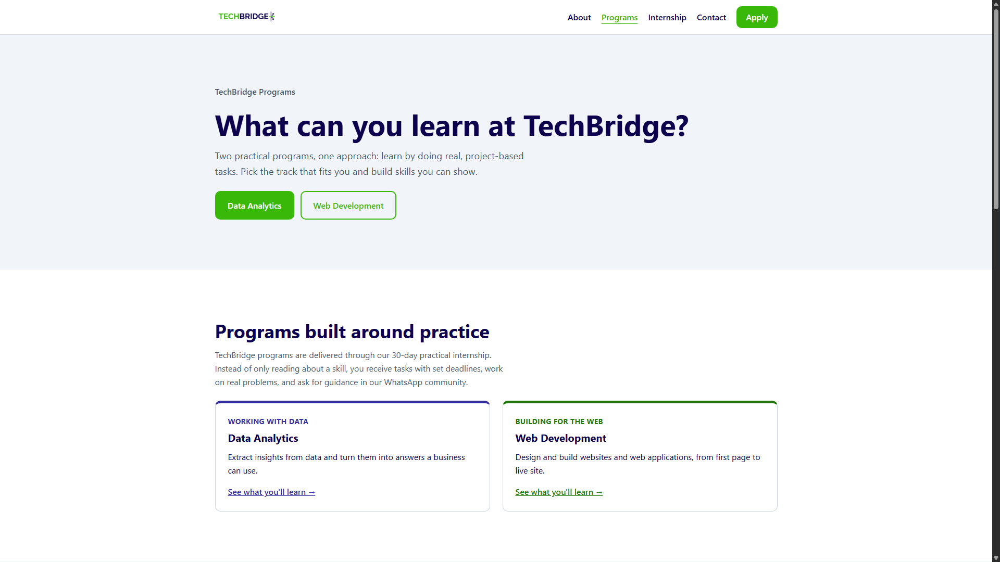
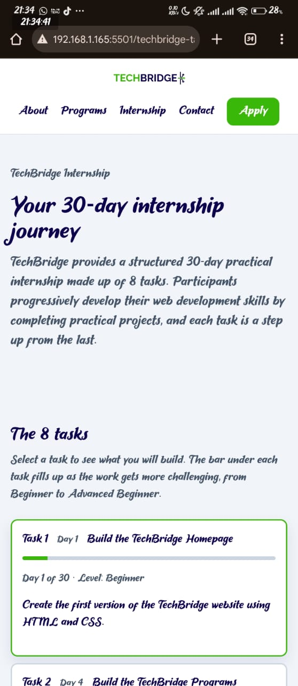

# TechBridge Task 2

Live site: https://new-git-stack.github.io/techbridge-task-3/

## Developer note
I presented the 8 tasks as cards in a responsive grid, each showing the task number, day, title, and a bar that fills up as the work gets more challenging. Clicking a card expands it to show the level and description, using the HTML details element so the page works without JavaScript. I chose cards because they let a new intern scan the whole internship at a glance and open only the task they want. I kept “Tasks” out of the navbar because it would have pushed the header onto three rows on mobile, so I linked to it from the internship section of the homepage and from each page’s footer instead. My main challenge was learning how to use CSS Grid, and working through it taught me how to build a layout that adapts from one column on mobile to three on desktop.
